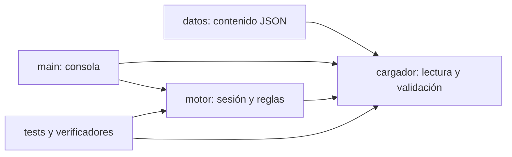

# Arquitectura y decisiones

El contenido define rutas y reglas. El cargador rechaza datos inválidos. El motor
mantiene el estado y aplica decisiones. La interfaz presenta resultados y recoge
entradas; captura ErrorHistoria y ErrorEleccion. No hay acceso a internet ni BD.

## ADR01 — Contenido externo

Alternativas: escenas en Python o JSON externo. Se elige JSON porque la escritora
puede editarlo y otra historia puede funcionar sin recompilar ni cambiar código.
Consecuencia: se debe mantener y validar un contrato de datos. La medida RNF01
comprueba huellas idénticas de motor, cargador e interfaz al recorrer la segunda
historia. Su verificación está en evidencias/evidencia_rnf.json.

## ADR02 — Control de estado

La instantánea única guarda la escena y una copia de todas las variables; se consume al deshacer. Alternativas: pila ilimitada u operaciones inversas. Se elige instantánea para cumplir un nivel sin calcular inversas; su memoria es proporcional a las variables. Una entrada inválida no la sustituye.

## Contrato de componentes

cargar_historia(ruta) devuelve un dict validado o lanza ErrorHistoria.
Motor(historia) valida y copia los datos; escena_actual y variables devuelven
copias. elegir(id) solo acepta opciones habilitadas; si falla no muta el estado.
reiniciar() restaura los valores originales. La escena final tiene cero opciones;
bloqueada distingue un bloqueo de un final legítimo.

puede_deshacer indica si existe respaldo; deshacer devuelve True si restauró y False si no había respaldo.
