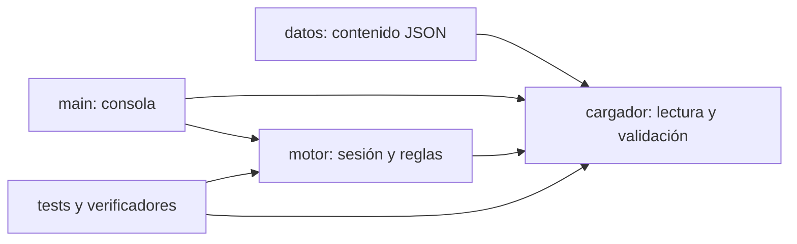
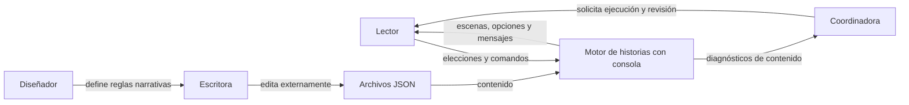
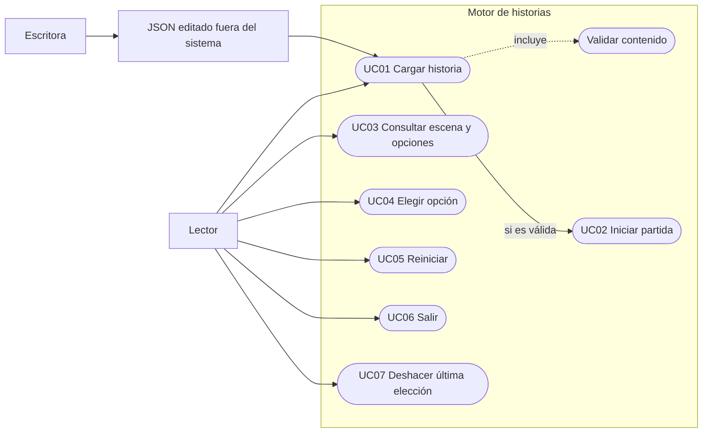
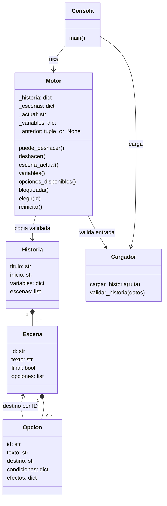
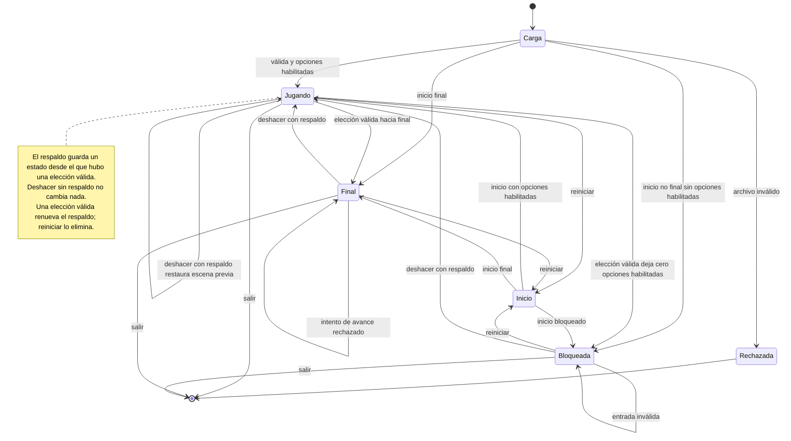

# Informe V2 — La última transmisión

Responsable: **Jesus Espitia**.
Revisión personal realizada y confirmada. Asistencia de Codex declarada en aportes.

---

# 1. Problema, actores, alcance y riesgos

## Problema

El colectivo necesita ofrecer ficción interactiva cuyas decisiones cambien el
desarrollo y el final. La escritora debe editar contenido sin modificar Python,
y la coordinadora necesita detectar errores antes de abrir una partida.
El motor interpreta escenas, condiciones y efectos desde archivos JSON.

## Actores e interesados

- Lector: consulta escenas, elige opciones, alcanza finales y reinicia.
- Escritora: edita el JSON fuera del programa; no existe editor visual.
- Diseñador: define condiciones y consecuencias.
- Coordinadora: necesita funcionamiento verificable y errores identificables.
- Equipo desarrollador: implementa, verifica y mantiene la solución.

## Alcance

Carga y validación JSON, inicio, presentación de escenas y opciones habilitadas,
elecciones válidas, rechazo de entradas inválidas, efectos booleanos, finales,
bloqueos y reinicio. Las historias se intercambian sin modificar el motor.
Incluye deshacer una última elección válida. No incluye persistencia, cuentas, internet, base de datos ni multimedia.

## Conflicto pendiente

La escritora quiere permitir retroceder siempre y el diseñador prefiere decisiones
irreversibles. Pregunta: ¿debe permitirse retroceder y con qué consecuencias sobre
las variables? El acuerdo provisional explícito de la guía es no implementar
retroceso en el alcance inicial. La solicitud posterior autoriza un nivel de retroceso y reemplaza este acuerdo.

## Dos riesgos

| Riesgo | Probabilidad / impacto | Mitigación |
|---|---|---|
| Referencias o tipos incorrectos en el contenido. | Media / alto. | Validar antes de iniciar y localizar el defecto en el mensaje; U1. |
| Una opción oculta se ejecuta enviando su ID directamente. | Media / alto. | Validar en el motor contra las opciones habilitadas; U3. |

## Calidad y responsabilidad

Prioridad 1: confiabilidad de estado y elecciones, porque un error altera la
historia. Prioridad 2: claridad de errores, porque el contenido lo edita una
persona no programadora. Prioridad 3: modificabilidad, para publicar otra historia
sin editar el motor. Los umbrales están en RNF01–RNF03.


---

# 2. Requisitos de la versión final

Las necesidades oficiales N01–N06 se transcriben de la imagen suministrada
por el estudiante. La correspondencia completa está al final de este documento
y en docs/06_trazabilidad.md.

## Requisitos funcionales

| ID | Comportamiento | Criterio de aceptación |
|---|---|---|
| RF01 | Cargar una narración desde la ruta JSON recibida. | Al cargar ambas historias incluidas se crean partidas sin modificar código; I1. |
| RF02 | Inicializar la escena y las variables con los valores del archivo. | Una nueva partida comienza en E1 con ambas variables falsas; U5. |
| RF03 | Mostrar solamente opciones cuyas condiciones de igualdad se cumplan todas. | E3 ofrece exactamente activar con código y cortar cuando conoce_origen es verdadero; si es falso, activar sin verificar y cortar; U2/U3. |
| RF04 | Rechazar IDs inexistentes o de opciones no habilitadas. | Intentar activar_codigo sin conocer el origen produce ErrorEleccion y deja escena y variables intactas; U3. |
| RF05 | Asignar todos los efectos de la elección válida. | Investigar establece conoce_origen verdadero y activar establece confia_en_la_voz verdadero; U2 e I1. |
| RF06 | Avanzar al destino de una elección válida conservando el resto del estado. | Revisar lleva a E2; investigar a E3; activar o cortar al final correspondiente; I1. |
| RF07 | Reconocer las escenas finales y no ofrecer avance desde ellas. | E4, E5 y E6 tienen final verdadero y cero opciones disponibles; I1. |
| RF08 | Rechazar historias que incumplan estructura, referencias, unicidad o tipos. | U1 rechaza las categorías de carga exigidas, incluido destino E99; no se crea sesión jugable. |
| RF09 | Informar errores de carga con causa y localización identificable. | Cada categoría de RNF02 informa campo, ID o archivo y motivo; main muestra el mensaje sin traceback de aplicación. |
| RF10 | Informar cuando una escena no final no tiene opciones habilitadas. | U4 confirma bloqueada verdadero; la interfaz muestra el bloqueo y ofrece reiniciar. |
| RF11 | Reiniciar en el estado original. | Después de investigar, reiniciar devuelve E1 y ambas variables falsas; U5. |

## Requisitos no funcionales

| ID | Umbral | Procedimiento y evidencia |
|---|---|---|
| RNF01, modificabilidad | Completar la segunda historia con cero cambios en motor, cargador e interfaz. | Comparar SHA-256 antes y después; herramientas/verificar_rnf.py, evidencias/evidencia_rnf.json:RNF01. |
| RNF02, claridad de errores | Nueve variantes de carga con causa y ubicación identificable. | Introducir cada defecto y comprobar mensajes; evidencias/evidencia_rnf.json:RNF02. |
| RNF03, confiabilidad | Tres ejecuciones de ocho escenarios con cero fallos y errores. | U1–U6, I1 e I2; evidencias/evidencia_rnf.json:RNF03. |

## Tres preguntas, respuestas o supuestos

1. ¿Se permite volver a una escena anterior? Existe conflicto entre la escritora
   y el diseñador. La guía establece no implementar retroceso en el alcance inicial;
   la solicitud de cambio lo reemplaza por un retroceso de una elección válida.
2. ¿Cómo se combinan varias condiciones? Supuesto: todas deben cumplirse (Y lógico).
   Un objeto de condiciones vacío, representada por {}, habilita siempre la opción.
3. ¿Qué sucede ante un bloqueo? La guía exige informar y permitir reiniciar.

## Trazabilidad

RF01 y RF08–RF09: cargador.py, U1 e I1. RF02 y RF11: Motor.reiniciar, U5.
RF03: Motor.opciones_disponibles, U2/U3. RF04–RF06: Motor.elegir, U2/U3/I1.
RF07: escenas finales e interfaz, I1. RF10: Motor.bloqueada e interfaz, U4.
Los cinco modelos incluidos se enlazan en docs/06_trazabilidad.md.

## Requisitos del cambio

| ID | Comportamiento | Aceptación |
|---|---|---|
| RF12 | Deshacer restaura exactamente escena y todas las variables previas a la última elección válida. | Investigar y deshacer devuelve E2 con conoce_origen falso; I1 verifica también regreso desde E4, E5 y E6; U6/I1. |
| RF13 | Permitir un solo nivel de retroceso, renovado por una elección válida posterior. | Tras deshacer, otro intento devuelve falso y no cambia nada; continuar después habilita otro retroceso; U6. |
| RF14 | Mantener el respaldo ante entradas inválidas. | Intentos inexistentes o no habilitados no sustituyen el respaldo; aún se puede deshacer investigar; U6. |
| RF15 | Iniciar sin retroceso y eliminarlo al reiniciar. | Al crear la partida y después de reiniciar puede_deshacer es falso; U5/U6. |

## Descomposición atómica de RF08

RF08 agrupa la validación; las siguientes unidades son requisitos verificables
por separado y mantienen el identificador padre para lectura de la matriz.

| ID | Comportamiento | Aceptación |
|---|---|---|
| RF08a | Rechazar lectura o estructura incorrecta. | U1 rechaza archivo ausente, JSON roto y raíz lista. |
| RF08b | Rechazar campos obligatorios ausentes. | U1 rechaza titulo ausente y nombra el campo. |
| RF08c | Rechazar inicio inexistente. | U1 rechaza inicio E99. |
| RF08d | Rechazar IDs de escenas duplicados. | U1 rechaza una segunda E1. |
| RF08e | Rechazar IDs de opciones duplicados dentro de una escena. | U1 rechaza revisar repetido en E1; I2 admite IDs iguales en escenas distintas. |
| RF08f | Rechazar destinos inexistentes. | U1 rechaza destino E99; consola no abre sesión. |
| RF08g | Rechazar variables no declaradas en condiciones o efectos. | U1 rechaza variable otra en ambos campos. |
| RF08h | Rechazar valores no booleanos en variables, condiciones o efectos. | U1 rechaza texto false e integer 1. |
| RF08i | Rechazar cantidad de opciones incompatible con final. | U1 rechaza final con opciones y no final vacía. |


## Presentación de la escena actual

| ID | Comportamiento | Criterio de aceptación |
|---|---|---|
| RF16 | Presentar el texto de la escena actual al iniciar y después de cada elección válida o reinicio. | La consola muestra el ID y texto de la escena vigente; main.py lee escena_actual y lo imprime en cada iteración. Evidencia: demo/transcripcion_consola.txt. |

RF16 explicita un comportamiento ya implementado en ambas versiones, sin cambiar
el programa. RF12–RF15 se reservan para la solicitud de cambio y solo aplican a V2.

## Correspondencia con las necesidades oficiales

| ID | Necesidad oficial | Requisitos que la atienden |
|---|---|---|
| N01 | Los escritores necesitan distribuir relatos en archivos independientes y definir dónde y con qué información comienza cada partida. | RF01, RF02 |
| N02 | Los lectores necesitan leer la escena actual y ver únicamente decisiones compatibles con la información obtenida. | RF03, RF16 |
| N03 | Elegir debe producir las consecuencias indicadas en el relato y llevar al destino previsto. Los errores de entrada no deben alterar la partida. | RF04, RF05, RF06 |
| N04 | La experiencia debe recordar durante la partida qué ha ocurrido para que las elecciones posteriores tengan consecuencias coherentes. | RF05, RF06; RF03 utiliza ese estado |
| N05 | El lector necesita reconocer el desenlace y comenzar otra partida sin conservar información de la anterior. | RF07, RF11 |
| N06 | El escritor necesita saber por qué un archivo no es válido antes de que alguien lo juegue. Los errores mínimos se precisan en la sección de validación. | RF08a–RF08i, RF09 (RF08 agrupa validación) |

RF10 deriva de la regla adicional de bloqueo indicada en la guía.
RF12–RF15 derivan de la solicitud de cambio, no de una redefinición de N01–N06.


---

# Proceso y agilidad — V2

Responsable de la entrega: Jesus Espitia. Proyecto preparado con asistencia de
Codex; el alcance de la ayuda y los aportes se declaran en docs/08_aportes_fuentes.md.

## Proceso y alternativa

Proceso incremental con tablero Kanban. Se prepara una base funcional, se ejecutan
pruebas y se revisan resultados antes del siguiente incremento. Alternativa:
cascada; se descarta porque el ejercicio anuncia un cambio dentro del plazo.

## Backlog

| ID | Resultado | Prioridad | Dependencias | Evidencia |
|---|---|---|---|---|
| B01 | Problema y requisitos | Alta | Guía y rúbrica | docs/01_problema.md; 02_requisitos.md |
| B02 | Contrato y cargador | Crítica | B01 | src/cargador.py; U1 |
| B03 | Motor y consola | Crítica | B02 | src/motor.py; main.py; U2–U5 |
| B04 | Dos historias | Alta | B03 | datos/; I1/I2 |
| B05 | Cinco modelos y arquitectura | Alta | B01–B03 | docs/modelos/; 04_arquitectura.md |
| B06 | Pruebas, RNF y evidencia | Crítica | B02–B04 | evidencias/ |
| B07 | Documentación, demostración y ZIP | Alta | B05/B06 | README; demo/ |
| B08 | Incorporar deshacer y ampliar pruebas | Crítica | V1 verificada | RF12–RF15, U6, docs/07_cambio.md |

## Tablero y evolución real

`evidencias/tablero_inicio.json` registra el inicio de esta preparación;
`evidencias/tablero_final.json` registra el resultado verificado. Son estados
locales fechados de esta sesión, no capturas inventadas de GitHub ni de la hora 6.
Al publicar, trasladar las tareas al tablero: Por hacer → En progreso → En revisión
→ Terminado. 

## Prácticas

1. Separación de responsabilidades aplicada en cuatro componentes: contenido,
   validación, sesión e interfaz; demostrada al ejecutar otra historia.
2. Regresión automatizada aplicada al comprobar condiciones, efectos, errores,
   reinicio y recorridos completos tras cada cambio.


## Definición de terminado

Requisito con aceptación, implementación consistente, pruebas que pasan, evidencia
conservable, documentación/modelos/trazabilidad actualizados y revisión del responsable.


## Aprendizaje y mejora

Durante la preparación previa, un temporal de pruebas La corrección usa TemporaryDirectory dentro del proyecto.
Acción de mejora: repetir pruebas desde el ZIP extraído, con archivos temporales
controlados; la revisión final registra esa ejecución.

## Revisión del responsable

Jesus Espitia confirmó la revisión personal del informe y el código, la ejecución
de la aplicación y las pruebas y la comprobación de funcionamiento. El tablero
final registra esta confirmación; los pendientes externos permanecen separados. 

:D the yisus firma.

---

# Arquitectura y decisiones



El contenido define rutas y reglas. El cargador rechaza datos inválidos. El motor
mantiene el estado y aplica decisiones. La interfaz presenta resultados y recoge
entradas; captura ErrorHistoria y ErrorEleccion. No hay acceso a internet ni BD.

## ADR01 — Contenido externo

Alternativas: escenas en Python o JSON externo. Se elige JSON porque la escritora
puede editarlo y otra historia puede funcionar sin recompilar ni cambiar código.
Consecuencia: se debe mantener y validar un contrato de datos. La medida RNF01
comprueba huellas idénticas de motor, cargador e interfaz al recorrer la segunda
historia. Su verificación está en evidencias/evidencia_rnf.json.

## ADR02 — Control de estado

La instantánea única guarda la escena y una copia de todas las variables; se consume al deshacer. Alternativas: pila ilimitada u operaciones inversas. Se elige instantánea para cumplir un nivel sin calcular inversas; su memoria es proporcional a las variables. Una entrada inválida no la sustituye.

## Contrato de componentes

cargar_historia(ruta) devuelve un dict validado o lanza ErrorHistoria.
Motor(historia) valida y copia los datos; escena_actual y variables devuelven
copias. elegir(id) solo acepta opciones habilitadas; si falla no muta el estado.
reiniciar() restaura los valores originales. La escena final tiene cero opciones;
bloqueada distingue un bloqueo de un final legítimo.

puede_deshacer indica si existe respaldo; deshacer devuelve True si restauró y False si no había respaldo.


---

# Plan de pruebas y resultados

| Caso | Entrada | Resultado esperado y aserciones |
|---|---|---|
| U1 | Historia válida y variantes de error | Inicio E1; assertRaisesRegex verifica causa/campo para cada defecto. |
| U2 | revisar, investigar | E3; conoce_origen verdadero; conjunto exacto activar_codigo/cortar. |
| U3 | revisar, continuar, activar_codigo, activar_sin_verificar | Rechazo del ID oculto; no avance; luego E5. |
| U4 | Condición imposible con variables iniciales | Bloqueo verdadero; rechazo de elección; reinicio a E1. |
| U5 | revisar, investigar, reiniciar | E1 y todas las variables iniciales. |
| I1 | JSON real, rutas de E4/E5/E6 y segunda historia | Finales verdaderos y sin avance; segunda historia llega a S5. |
| I2 | Segunda historia, O2; O1/O2; O1/O1; O3/O1 | S3/S4/S5 alcanzables; desde O3, O1 oculta y rechazada. |
| U6 | Elegir, entradas inválidas, deshacer repetido y nueva elección | Restauración exacta, respaldo conservado ante invalidez, consumido al deshacer y renovado con elección válida. |

U5 comprueba además limpieza del respaldo; I1 deshace desde cada final.

## Cobertura de errores

| Categoría | Evidencia |
|---|---|
| Archivo ilegible / estructura incorrecta | U1: ruta inexistente, JSON roto, raíz no objeto. |
| Campo obligatorio ausente | U1: campo titulo ausente. |
| Inicio inexistente | U1: inicio E99. |
| IDs duplicados en su ámbito | U1: escena repetida y opción repetida; I2 admite IDs de opción iguales en escenas distintas. |
| Destino inexistente | U1: destino E99; prueba de consola rechaza antes de jugar. |
| Variable no declarada | U1: condiciones y efectos con variable otra. |
| Valor no booleano | U1: condiciones/efectos con 1 y variable inicial con texto false. |
| Opciones incompatibles con final | U1: no final vacía y final con opciones. |
| No final sin opciones habilitadas | U4 y comprobación de consola. |

RNF02 desglosa la duplicación de escenas y opciones en dos diagnósticos de carga;
el bloqueo se verifica aparte durante ejecución. No se confunden validación
estática y disponibilidad de opciones durante una partida.

## Ejecución reproducible

Desde la raíz: `python -m unittest discover -s tests -v`,
`python herramientas/verificar_rnf.py` y `python herramientas/comprobar_consola.py`.
Resultados reales: evidencias/evidencia_pruebas.txt, evidencia_rnf.json y
evidencia_consola.txt. evidencias/verificacion_zip.txt comprueba el paquete extraído.
No se infiere ausencia de cualquier defecto a partir de esta cobertura.


---

# Matriz de trazabilidad

## Necesidades oficiales y cobertura

Fuente: docs/fuentes/necesidades_oficiales.png.

| ID | Necesidad oficial | Requisitos que la atienden |
|---|---|---|
| N01 | Los escritores necesitan distribuir relatos en archivos independientes y definir dónde y con qué información comienza cada partida. | RF01, RF02 |
| N02 | Los lectores necesitan leer la escena actual y ver únicamente decisiones compatibles con la información obtenida. | RF03, RF16 |
| N03 | Elegir debe producir las consecuencias indicadas en el relato y llevar al destino previsto. Los errores de entrada no deben alterar la partida. | RF04, RF05, RF06 |
| N04 | La experiencia debe recordar durante la partida qué ha ocurrido para que las elecciones posteriores tengan consecuencias coherentes. | RF05, RF06; RF03 utiliza ese estado |
| N05 | El lector necesita reconocer el desenlace y comenzar otra partida sin conservar información de la anterior. | RF07, RF11 |
| N06 | El escritor necesita saber por qué un archivo no es válido antes de que alguien lo juegue. Los errores mínimos se precisan en la sección de validación. | RF08a–RF08i, RF09 (RF08 agrupa validación) |

RF10 atiende además la regla explícita de bloqueo.

## Requisitos, modelos, código y evidencia

Los modelos M01–M05 están en docs/modelos/. Las funciones U/I están en
tests/test_motor.py y su resultado está en evidencias/evidencia_pruebas.txt.

| Requisito | Necesidad / origen | Modelos | Archivos | Verificación localizable |
|---|---|---|---|---|
| RF01 | N01 | M01/M02/M04 | src/cargador.py | tests/test_motor.py: I1/I2 |
| RF02 | N01 | M02/M03/M04/M05 | src/motor.py; src/main.py | tests/test_motor.py: U5 |
| RF03 | N02, N04 | M02/M03/M04/M05 | src/motor.py; src/main.py | tests/test_motor.py: U2/U3 |
| RF04 | N03 | M02/M03/M04/M05 | src/motor.py; src/main.py | tests/test_motor.py: U3 |
| RF05 | N03, N04 | M02/M03/M04/M05 | src/motor.py; src/main.py | tests/test_motor.py: U2/I1 |
| RF06 | N03, N04 | M02/M03/M04/M05 | src/motor.py; src/main.py | tests/test_motor.py: I1 |
| RF07 | N05 | M02/M03/M04/M05 | src/motor.py; src/main.py | tests/test_motor.py: I1 |
| RF08 | N06 | M01/M02/M04 | src/cargador.py | tests/test_motor.py: U1 |
| RF09 | N06 | M01/M02/M04 | src/cargador.py | tests/test_motor.py: U1; consola |
| RF10 | Regla explícita de bloqueo de la guía; complementa N02/N05 | M02/M03/M04/M05 | src/motor.py; src/main.py | tests/test_motor.py: U4; consola |
| RF11 | N05 | M02/M03/M04/M05 | src/motor.py; src/main.py | tests/test_motor.py: U5 |
| RF12 | Solicitud de cambio; complementa N03/N04 | M02/M03/M04/M05 | src/motor.py; src/main.py | tests/test_motor.py: U6/I1 |
| RF13 | Solicitud de cambio | M02/M03/M04/M05 | src/motor.py; src/main.py | tests/test_motor.py: U6 |
| RF14 | Solicitud de cambio; complementa N03 | M02/M03/M04/M05 | src/motor.py; src/main.py | tests/test_motor.py: U6 |
| RF15 | Solicitud de cambio; complementa N05 | M02/M03/M04/M05 | src/motor.py; src/main.py | tests/test_motor.py: U5/U6 |
| RF16 | N02 | M01/M02/M04 | src/main.py; motor.py:escena_actual | demo/transcripcion_consola.txt |
| RNF01 | N01 | M01/M03; arquitectura | datos/; src/ | evidencias/evidencia_rnf.json:RNF01 |
| RNF02 | N06 | M02/M04 | src/cargador.py; main.py | evidencias/evidencia_rnf.json:RNF02.casos |
| RNF03 | N02–N05 | M04/M05 | tests/; src/ | evidencias/evidencia_rnf.json:RNF03.ejecuciones |

## Detalle de RF08

RF08a–RF08i se vinculan individualmente con N06, M02/M04,
src/cargador.py:validar_historia (RF08a también cargar_historia), y sus variantes
U1 identificadas por datos y mensajes en tests/test_motor.py. Resultado conjunto
en evidencias/evidencia_pruebas.txt; diagnósticos RNF02 en evidencia_rnf.json.


---

# Análisis e implementación del cambio

## Decisión recibida

El lector puede deshacer su última elección válida. Deben restaurarse la escena y
todas las variables anteriores. Solo hay un nivel: deshacer consume el respaldo
hasta una nueva elección válida. Inicio y reinicio no permiten retroceder. Una
opción inválida no modifica sesión ni respaldo. Desde E4/E5/E6 se vuelve a E3.
Esta decisión sustituye el acuerdo inicial sin retroceso.

## Versión de partida e impacto

La V1 se identifica mediante VERSION y los SHA-256 de evidencias/base_v1.json.
El historial local actual identifica commits V1 y V2; no representa la hora 6.

| Artefacto | Cambio | Evidencia |
|---|---|---|
| RF | Añadir RF12–RF15 | docs/02_requisitos.md |
| Motor | Respaldo único; deshacer; disponibilidad; limpieza en reinicio | src/motor.py |
| Interfaz | Comando :deshacer y mensaje cuando no hay respaldo | src/main.py |
| Cargador y JSON | Contrato conservado; sin campos nuevos | Comparación de huellas V1/V2 |
| Modelos | UC07, respaldo en clase, secuencia de restauración, transiciones desde final | docs/modelos/M02–M05 |
| Backlog | Incorporar B08 | docs/03_proceso.md |
| Pruebas | Añadir U6; extender U5 e I1 | tests/test_motor.py |
| RNF y trazabilidad | Ocho escenarios y referencias al cambio | docs/06_trazabilidad.md; evidencias/ |

## Implementación

elegir valida antes de mutar. Si la elección es válida guarda (_actual,
_variables.copy()), asigna efectos y avanza. deshacer restaura ese par y elimina
el respaldo; no existe rehacer ni pila de estados. reiniciar lo elimina también.
Como las variables son booleanas, una copia simple del dict es suficiente.

## Aceptación y resultados

U6 comprueba restauración exacta, entrada inválida que preserva el respaldo,
segundo intento sin cambios y nueva elección que vuelve a habilitar retroceso.
U5 comprueba inicio/reinicio sin respaldo; I1 comprueba el regreso desde E4/E5/E6.
El ejemplo revisar → investigar → deshacer → continuar muestra en E3 activar sin
verificar y cortar. La demostración registra ese flujo y la restauración desde E5.
Resultados reales en evidencias/ y demo/; no se crea una prueba nueva de resultado
esperado sin ejecutarla.


---

# Responsable, aportes y herramientas de apoyo

**Responsable de la entrega: Jesus Espitia.**

## Declaración de elaboración y asistencia

Este proyecto se presenta bajo la responsabilidad de Jesus Espitia. Para su
preparación se utilizó Codex como herramienta de apoyo de inteligencia artificial.
La ayuda comprendió generación y adaptación de código Python, ayuda en documentación, elaboración de modelos, preparación de pruebas automatizadas,
ejecución de verificaciones y organización de los archivos de entrega.


| Participación | Trabajo y evidencia |
|---|---|
| Jesus Espitia | Aportó la guía, rúbrica, historias/repositorio, solicitud de cambio y tabla oficial N01–N06; indicó el alcance de V1/V2, documentacion. Materiales conservados en docs/fuentes/ y datos/. |
| Codex, herramienta de apoyo | Preparó y adaptó src/, tests/, herramientas/, modelos y demostración; ejecutó pruebas y verificaciones cuyos resultados están en evidencias/. |
| Revisión personal realizada | Jesus Espitia confirmó haber leído y revisado el informe y el código, ejecutado la aplicación y las pruebas y comprobado su funcionamiento. Esta declaración se registra a partir de su confirmación; la evidencia automatizada se conserva en evidencias/. |

## Verificación

Se ejecutaron escenarios unitarios y de integración, mediciones locales de los
tres RNF, comprobaciones de consola y pruebas desde paquetes descomprimidos.
Los resultados reales se incluyen en evidencias/. La demostración automatizada
presenta salidas de ejecución.

## Fuentes y bibliotecas

rúbrica, JSON, repositorio y tabla oficial aportados por el estudiante.
V2 usa además la solicitud de cambio suministrada como imagen.

se usaron tutoriales y fragmentos de terceros adicionales para implementar el
motor. La aplicación usa biblioteca estándar de Python. Pillow se utilizó para
producir las imágenes del video de evidencia, no es dependencia de la aplicación.

## Modalidad de entrega

Se solicita presentar este material individualment.

## Declaración del responsable

Revisé el informe y el código, ejecuté la aplicación y las pruebas y comprobé su
funcionamiento. Para desarrollar el proyecto utilicé Codex como herramienta de
apoyo en la generación y adaptación de código, documentación, modelos y pruebas.

— Jesus Espitia


---

# Revisión final V2

| Criterio de rúbrica | Evidencia |
|---|---|
| Problema y calidad (10) | docs/01_problema.md; prioridades, dos riesgos y responsabilidad. |
| Proceso y agilidad (10) | docs/03_proceso.md; tablero_inicio/final.json. |
| Requerimientos (20) | docs/02_requisitos.md; aceptación, RNF, preguntas. Cobertura oficial N01–N06 incorporada. |
| Modelado (15) | docs/modelos/M01–M05, fuentes Mermaid y vista en Markdown. |
| Arquitectura (15) | docs/04_arquitectura.md; componentes, dos decisiones y segunda historia. |
| Implementación y pruebas (20) | src/, tests/, evidencias/; 8 escenarios correctos y tres RNF. |
| Cambio y trazabilidad (10) | docs/07_cambio.md y 06_trazabilidad.md. |

No se asigna una nota: la evaluación corresponde al docente y depende de confirmar
los pendientes. La versión inicial por sí sola no cubre la fase de cambio.

## Comprobaciones técnicas

Los tres finales son alcanzables; las condiciones cambian las opciones; la segunda
historia funciona con el mismo motor; errores controlados; pruebas y RNF correctos.
La ejecución desde el ZIP se registra en evidencias/verificacion_zip.txt.
El video de demo muestra salidas reales y está rotulado como demostración automatizada.

## Revisión personal realizada

Jesus Espitia confirmó haber revisado el informe y el código, ejecutado la
aplicación y sus pruebas y comprobado el funcionamiento. El apoyo de Codex
permanece declarado en docs/08_aportes_fuentes.md.

## Confirmaciones restantes antes del envío

- Confirmar con el docente la modalidad individual para Jesus Espitia.(profe no consegui grupo)
- Confirmar que el formato de video automatizado satisface lo solicitado o grabar
  una presentación propia siguiendo demo/transcripcion.txt.(si)
- Usar el nombre de archivo que autorice el docente para la modalidad individual; propuesta: Parcial_EspitiaJesus.zip.
- Subir al aula, verificar acceso y conservar el comprobante real de envío.(si)


---

# M01 contexto





---

# M02 casos uso

Representación de casos de uso con nodos y relaciones. Final y bloqueo son resultados de elegir, no acciones autónomas del lector.




---

# M03 clases

Historia, Escena y Opcion son estructuras conceptuales implementadas como diccionarios JSON; no se afirman clases Python inexistentes. Cargador y Consola representan módulos. Motor sí es una clase Python. escena_actual, variables y bloqueada son propiedades.




---

# M04 secuencia


```mermaid
sequenceDiagram
    actor L as Lector
    participant UI as main.py
    participant C as cargador.py
    participant M as Motor
    L->>UI: Ejecutar con ruta JSON
    UI->>C: cargar_historia(ruta)
    alt Contenido inválido
        C-->>UI: ErrorHistoria con causa y campo
        UI-->>L: Mensaje; no se crea partida
    else Contenido válido
        C-->>UI: historia validada
        UI->>M: Motor(historia)
        M->>C: validar_historia(historia)
        M->>M: reiniciar()
        UI->>M: escena_actual / opciones_disponibles()
        M-->>UI: escena y opciones habilitadas
        UI-->>L: Presentar información
        L->>UI: ID de opción
        UI->>M: elegir(id)
        M->>M: Buscar entre opciones habilitadas
        alt ID inválido o no habilitado
            M-->>UI: ErrorEleccion sin modificar sesión
            UI-->>L: Mostrar error y continuar
        else Elección válida
            M->>M: Copiar escena y variables en respaldo único
            M->>M: Aplicar efectos y cambiar destino
            UI->>M: Consultar escena y opciones nuevas
            UI-->>L: Nueva escena, final o bloqueo
        end
    end
    opt Usuario solicita deshacer, incluso desde final
        L->>UI: :deshacer
        UI->>M: deshacer()
        alt Existe respaldo
            M->>M: Restaurar escena y todas las variables
            M->>M: Consumir respaldo
            M-->>UI: True
        else No existe respaldo
            M-->>UI: False sin cambios
        end
        UI-->>L: Estado restaurado o mensaje
    end
```


---

# M05 estados




