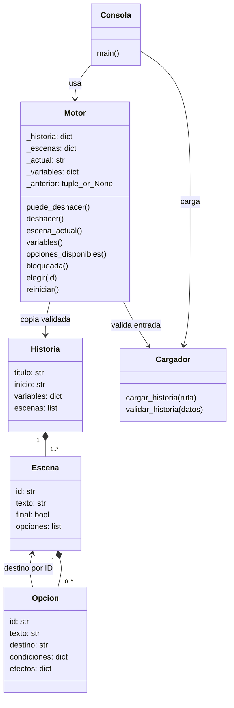

# M03 clases

Historia, Escena y Opcion son estructuras conceptuales implementadas como diccionarios JSON; no se afirman clases Python inexistentes. Cargador y Consola representan módulos. Motor sí es una clase Python. escena_actual, variables y bloqueada son propiedades.

